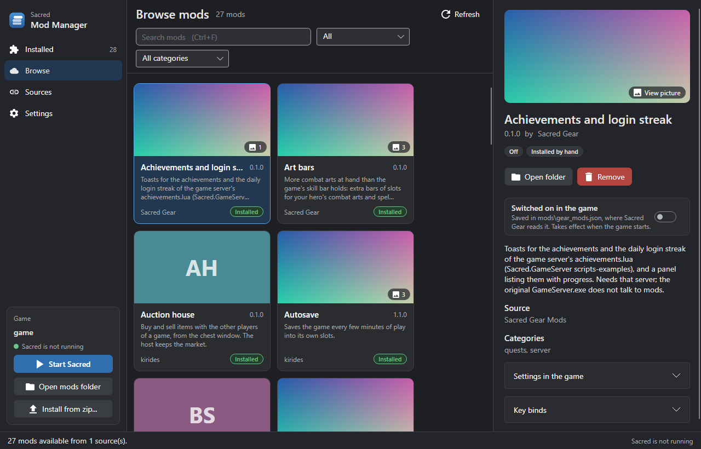

# Gear Mod Manager

Install, update and switch on **Sacred Gear mods** for Sacred Gold with a few clicks. Also handles plugins (like `ddraw.dll`) and tools.

## Get started

1. **Download** the newest build from [Releases](https://github.com/kirides/sacred-mod-manager/releases):
   `Gear-Mod-Manager-nightly-win-x64.zip` (Windows) or `Gear-Mod-Manager-nightly-linux-x64.AppImage` (Linux).
2. **Start it.** Windows: unzip anywhere and run `Gear Mod Manager.exe`. Linux: make the AppImage executable (`chmod +x`) and run it.
3. **Pick your Sacred folder** (the one with `Sacred.exe`) under **Settings**. It is usually found by itself.
4. Open **Browse** and press **Install** on the mods you want. What a mod needs is installed with it.
5. Close Sacred if it is running, press **Start Sacred**. Switch mods on and off on the **Installed** page.

## Update

A blue number on **Browse** means updates are waiting: open it and press **Update all**. Made a mistake? **Ctrl+Z** undoes it.

## More mods

Open **Sources**, paste the address of a mod list (for example a GitHub page like `https://github.com/kirides/sacred-gear-mods`) and press **Add**.
The Sacred Gear mods are already there. A `gear-mod-manager://` link on a web page does the same with one click.

## Good to know

* Close Sacred before you change mods; the manager tells you if it is still running.
* Updates only overwrite files, they never delete anything. Your saves and settings stay where they are.
* Every change keeps a backup, so you can go back.

## More

[Features](docs/Features.md) | [For mod authors: the mod index](docs/ModIndex.md) | [Links](docs/Links.md) | [Development](docs/Development.md)

MIT license, see [LICENSE](LICENSE). Third-party: Avalonia (MIT), CommunityToolkit.Mvvm (MIT), LuaCSharp (MIT), Material Design icon paths (Apache 2.0).
