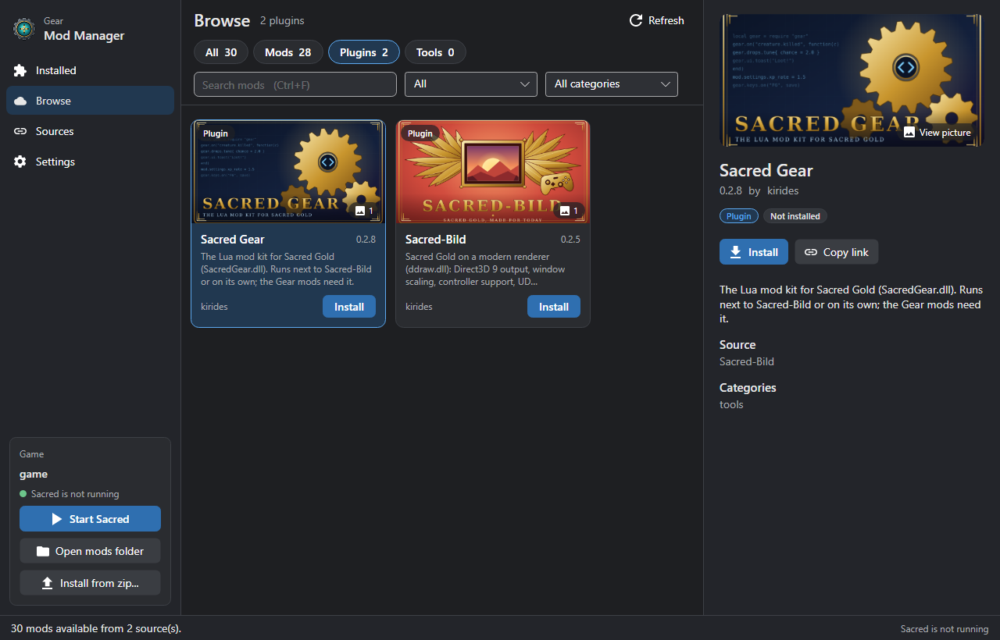

# Gear Mod Manager

Install, update and switch on **Sacred Gear mods** for Sacred Gold with a few clicks. Also handles plugins (like `ddraw.dll`) and tools.

## Get started (5 steps, no experience needed)

1. **Download.** Open the [Releases page](https://github.com/kirides/sacred-mod-manager/releases), scroll to **Assets** of the newest release and click
   `Gear-Mod-Manager-nightly-win-x64.zip` (Windows) or `Gear-Mod-Manager-nightly-linux-x64.AppImage` (Linux).
2. **Put it into your Sacred folder.** That is the folder that contains `Sacred.exe` (in GOG usually `C:\GOG Games\Sacred Gold`).
   Unzip the download and copy everything inside, `Gear Mod Manager.exe` and the other files, into that folder.
   (Not sure where it is? In Steam: right-click Sacred Gold, *Manage*, *Browse local files*.)
3. **Start `Gear Mod Manager.exe`** with a double click. It finds your game by itself because it sits next to `Sacred.exe`.
   If Windows says "Windows protected your PC": click **More info**, then **Run anyway** (the program is new and not signed). On Linux the AppImage can live anywhere: make it executable (`chmod +x`), run it, and pick your Sacred folder under **Settings**.
4. **Click Browse, then Install.** First the tab **Plugins**: install *Sacred-Bild* and *Sacred Gear*. Then the tab **Mods**: install what you like.
   Everything a mod needs is installed with it.
5. **Close Sacred if it runs, then press Start Sacred** (bottom left). Switch mods on and off on the **Installed** page.

## Sacred-Bild, Sacred Gear and the mods

The manager comes with two *sources* already added: **Sacred-Bild** (the new renderer, `ddraw.dll`) with **Sacred Gear** (`SacredGear.dll`, which the mods need) and the **Gear mods**.
That is why Browse is full on the first start. A plugin copies its file next to `Sacred.exe`; a file you already had (your own `ddraw.dll`) is saved and comes back when you remove the plugin.

Want mods from somebody else? Open **Sources**, paste the address of their mod list (for example a GitHub page like `https://github.com/someone/their-mods`) and press **Add**.
(Or click an **install banner**, see below: the manager opens, asks "Add this mod source?", press **Add source**.)

**What is an install banner?** A button or link on a web page (`gear-mod-manager://...`) that says "add this source" or "install this mod". Your browser asks to open Gear Mod Manager,
and the manager asks you again before it does anything, so nothing happens behind your back. It works after you started the manager once (it registers itself for these links).
Page authors: [how to make a banner](docs/Links.md#install-banners-for-page-authors).

## Update

A blue number on **Browse** means updates are waiting: open it and press **Update all**. Made a mistake? **Ctrl+Z** undoes it.

## Good to know

* A blue banner at the top tells you when a new version of the manager exists; **Click here** opens the download page (nothing is installed behind your back).
* Close Sacred before you change mods; the manager tells you if it is still running.
* Updates only overwrite files, they never delete anything. Your saves and settings stay where they are.
* Every change keeps a backup, so you can go back.

## More

[Features](docs/Features.md) | [For mod authors: the mod index](docs/ModIndex.md) | [Links](docs/Links.md) | [Development](docs/Development.md)

MIT license, see [LICENSE](LICENSE). Third-party: Avalonia (MIT), CommunityToolkit.Mvvm (MIT), LuaCSharp (MIT), Material Design icon paths (Apache 2.0).
