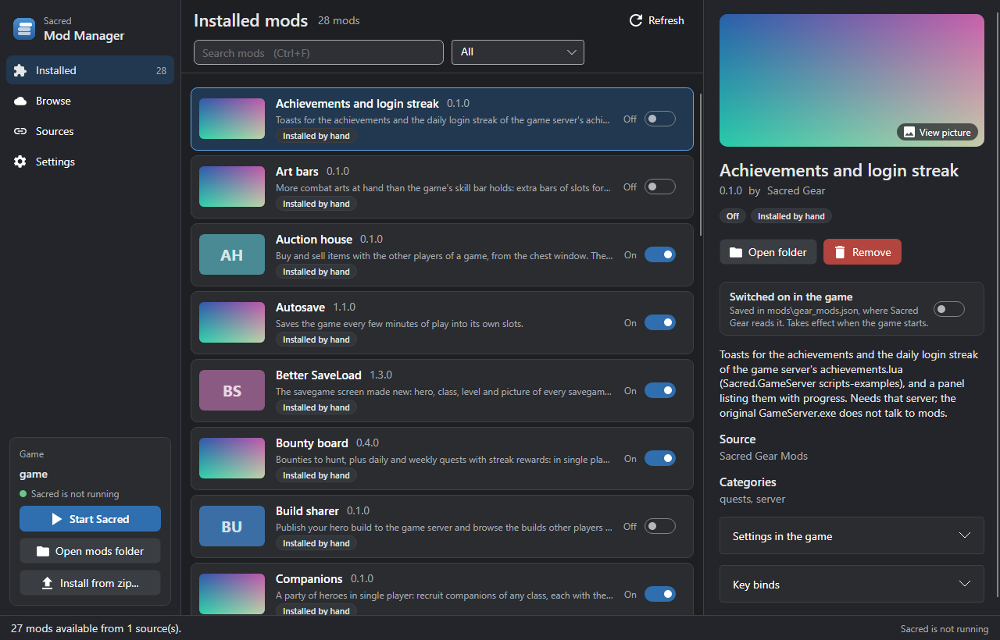
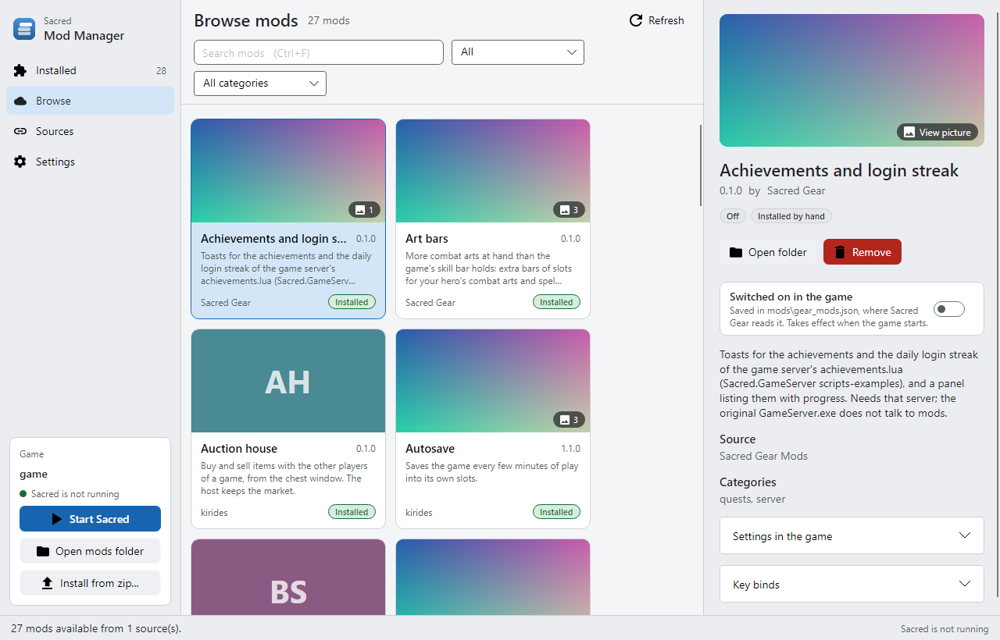
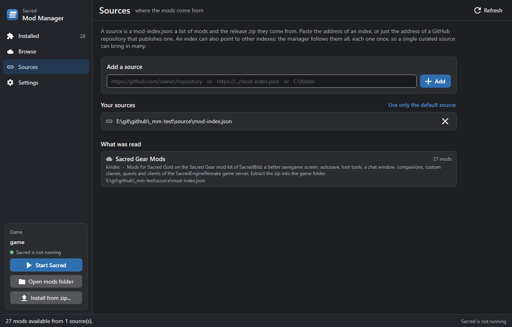

# Gear Mod Manager


A Windows desktop app that installs, updates, switches on and off and removes **Sacred Gear** mods for **Sacred Gold**. Mods come from
**mod indexes**: small `mod-index.json` files that list mods and the release zip they live in. Add a source once (a GitHub repository
address is enough) and browse, install and update from it; an index can also point to other indexes, so one curated list can bring in
many.





* Native AOT, `win-x64`, trimmed, **zero warnings**; .NET 11, Avalonia 12 (first party controls, Fluent theme, light and dark),
  CommunityToolkit.Mvvm source generators, runtime async (`<Features>runtime-async=on</Features>`), compiled bindings everywhere, `System.Text.Json` with source-generated contexts only.
* The game folder is only touched below `<game>\mods\`. Nothing else is written there.
* Reads each mod's `mod.lua` in a locked-down Lua sandbox ([below](#how-mod-information-is-read)); mod code is never run.

## What it does

| | |
|---|---|
| **Installed** | Every mod in `<game>\mods\` with its version, author, description, state and an On/Off switch. Filters: on, off, updates, problems, installed by hand. Search by name, id, author, description, category. The detail pane shows the mod's requirements, the settings and key binds it declares, and whether files were changed since the install. |
| **Mods, Plugins, Tools** | Both lists have tabs for the three kinds of entries an index can offer: Sacred Gear **mods** (On/Off switch), **plugins** (files for the game folder such as `ddraw.dll` or `SacredGear.dll`; a file you already had is saved and put back when the plugin is removed) and **tools** (programs such as the class editor, unpacked into the tools folder, with a Start button). Entries can be for one platform only, and a download can name a GitHub release (`download.github` + an asset pattern) when the asset's name carries a version. See [docs/ModIndex.md](docs/ModIndex.md#kinds-mods-plugins-and-tools). |
| **Browse** | The mods of all sources as cards with a picture (a path inside the release zip, or an https URL). A click on the picture opens a **carousel** with all the `images` of the mod (arrow keys, dots, `Esc`). Install and Update buttons, category filter. Installing a mod installs what it **requires** first (the dialog lists them). |
| **Sources** | Add, remove and refresh sources. Shows every index that was read, including the ones another index pointed to (indented), their mod counts and errors. |
| **Settings** | Game folder (found automatically in the usual places and the GOG registry entry), theme, where the manager keeps its files. |

Comfort that matters when you have many mods:

* **Update all** with one button; the Browse badge counts available updates.
* **Undo** (`Ctrl+Z`, also the link in the status bar) for On/Off, install, update, removal. Before a mod is replaced or removed its folder is copied to
  `%LOCALAPPDATA%\SacredModManager\backups`; **Restore previous** puts the last copy back (the five latest are kept).
* **Safe updates**: files the manager wrote are replaced, files the mod made itself (`config.lua`, saved data) are kept, files the new version no
  longer has are removed. If you edited a shipped file the detail pane says so, and the old copy is in the backup.
* **Safe removal**: removes the files the manager wrote and keeps the mod's own data unless you tick *also delete the data and settings*.
* **The game is respected**: while `Sacred.exe` runs the manager refuses to change mods (the game keeps files open and rewrites `gear_mods.json`)
  and says so in a banner. When the game ends the list refreshes itself; so it does when the window gets the focus.
* **Start Sacred** and **Open mods folder** are one click away. Drop a mod **zip** onto the window (or *Install from zip*, `Ctrl+O`) to install mods that
  are not in any index.
* Mods that were put into `mods\` by hand are listed as *Installed by hand* and can be updated from a source, removed or switched like any other.
* Fully usable with the keyboard: `Ctrl+1..4` pages, `Ctrl+F` search, `F5` refresh, `Ctrl+Z` undo, `Ctrl+O` zip, arrows in lists, `Escape` answers a question with "no".
  Questions are asked inside the window; the safe answer has the focus.




## Links

The manager handles `gear-mod-manager://` links (Windows and Linux, registered for the current user): `gear-mod-manager://add-index?url=<index address>` adds a source,
`gear-mod-manager://install?mod=<id>&index=<index address>` installs a mod. It always asks first. **Copy link** (a mod's detail pane, a source) builds them. Details,
registration and the single-instance hand-over: **[docs/Links.md](docs/Links.md)**.

## Where the On/Off state lives

Sacred Gear keeps the player's choices in `<game>\mods\gear_mods.json`: `{"mods": {"<id>": {"enabled": bool, "settings": {...}, "keys": {...}, "migrated": {...}}}}`.
The manager only ever changes `enabled`. Every change re-reads the file, edits it and writes it back atomically (same folder, temp file, move), so
settings, key binds and any field it does not know survive untouched. A file that cannot be parsed is never overwritten; the manager tells you
and leaves it alone. A mod without an entry follows its own default (`enabled = false` in its `mod.lua` means off until switched on).

The manager's own record of what it installed (version, source, every file with its SHA-256) is `<game>\mods\sacred-mod-manager.json`, so it travels
with the game folder.

## Mod indexes

A `mod-index.json` names a publisher, the release zip and its mods; the schema, the rules for `path` and `thumbnail`, meta-indexes (an index that lists its
own mods **and** references other indexes; each index is read once, cycles are harmless, depth and count are capped) and a script that generates the
file from a mods repository are in **[docs/ModIndex.md](docs/ModIndex.md)**. A source can be typed as

* `https://github.com/owner/repository` (its `mod-index.json` on the default branch),
* the https URL of an index file (`.../releases/latest/download/mod-index.json`),
* a local file or folder (handy while you write an index).

The default source is the index of [sacred-gear-mods](https://github.com/kirides/sacred-gear-mods).

## How mod information is read

`mod.lua` is a Lua file that returns a table. The manager reads it with [LuaCSharp](https://github.com/nuskey8/Lua-CSharp) in a state that has **no
libraries at all**: no `io`, `os`, `require`, `load*`, `dofile`, `debug`, no pattern matching, and an empty global table (like Sacred Gear's own manifest loader). The only
addition is a short list of string methods (`("bar%d"):format(n)`, `:sub`, `:rep`, `:lower`, `:upper`, `:len`, `:reverse`, `:byte`, `:char`) that real manifests use to build key lists;
they cannot be reached by name, refuse strings over 64 KB and field widths over 99. A hook counts **every instruction** (limit 2 million), watches the memory the
thread allocates (limit 48 MB) and the clock (2 s), call depth is 64, and the source is limited to 256 KB. A manifest that breaks a limit is reported as
"cannot be loaded" with the reason; nothing else happens. Zip files are unpacked only after every entry name is checked (no `..`, absolute paths, drive letters,
device names), with caps on file count and size.

## Nightly builds

`.github/workflows/nightly.yml` builds **Native AOT** binaries for **Windows x64** and **Linux x64** every night (02:17 UTC, or by hand under Actions, *Run workflow*;
*force* builds without new commits). Each build is its own pre-release, tagged `nightly-<sha7>` and titled **"Nightly - YYYY-MM-DD HH:mm - <sha7>"** (UTC); nightlies are kept,
none replaces another. A night without a new commit builds nothing, and a commit whose nightly lacks a platform (a build failed) is built again the next night. Each build runs the
whole test suite on its platform first (the Linux job also runs the Linux-only desktop-file test), publishes with warnings as errors, and packs
`Gear-Mod-Manager-nightly-win-x64.zip` / `Gear-Mod-Manager-nightly-linux-x64.tar.gz`. A failing platform does not cancel the release of the other. Nightlies are not releases and can be broken.

## Build, test, publish

Requires the .NET 11 SDK (see `global.json`; the projects target `net11.0` with `runtime-async=on` in `Directory.Build.props`) and, for the AOT publish, the Visual Studio C++ build tools.

```powershell
dotnet build SacredModManager.slnx
dotnet test --solution SacredModManager.slnx

# Native AOT, trimmed, zero warnings (warnings are errors)
$env:PATH += ";C:\Program Files (x86)\Microsoft Visual Studio\Installer"   # the AOT targets call vswhere.exe
dotnet publish src/SacredModManager -c Release -r win-x64 -o publish

# Linux (on Linux, with clang and zlib1g-dev installed)
dotnet publish src/SacredModManager -c Release -r linux-x64 -o publish
```

`publish\Gear Mod Manager.exe` (about 19 MB) is the app (the registered link starts it by this name; the assembly is called `GearModManager` because Avalonia finds its resources by assembly name, so the project renames the program file after publish); Avalonia's three native libraries (`libSkiaSharp.dll`, `libHarfBuzzSharp.dll`, `av_libglesv2.dll`) sit
next to it, native AOT cannot fold them in.

| Flag | What |
|---|---|
| `--selftest <index address>` | headless, in a temporary game folder: loads the index, installs a mod with what it requires, switches it off and on, removes, restores, updates; prints one line per check. Proves the published exe does the file, zip, Lua and JSON work |
| `--game <folder>` | use this game folder instead of the saved one; nothing is saved to the settings (use a **copy** for tests) |
| `--link <link>` | (with `--screenshot`, repeatable) handle the link and save the dialog it opens |
| `--source <address>` | use this source instead of the saved ones (repeatable); nothing is saved |
| `gear-mod-manager://...` | a link as the only argument: handed to the running manager, or the manager starts and asks about it |
| `--screenshot <dir>` | save a PNG of every page in light and dark and exit (the images of this README) |

`SACRED_MODMANAGER_HOME` moves the settings and all data (default: `%APPDATA%\SacredModManager`, `%LOCALAPPDATA%\SacredModManager`).
`tools/make_test_env.py <dir> --copy-mods <game>\mods` builds a throw-away game folder with a local index and the real release zip, and prints the command line.

The solution: `src/SacredModManager.Core` (indexes, loader, packages, store, `gear_mods.json`, the Lua reader, links; no UI), `src/SacredModManager` (Avalonia app) and
`tests/SacredModManager.Tests` (xunit.v3: sandbox escapes and limits, meta-index traversal, zip-slip, install/update/remove/restore of mods, plugins and tools, `gear_mods.json`
round trips, links, theme contrast).

The app is sliced by feature, not by type: a feature's view, view model and helpers sit side by side.

```
src/SacredModManager/
  Features/
    Shell/       MainWindow(.axaml, .cs), MainWindowViewModel (+ .Links.cs): navigation, game folder, loading, every action
    ModList/     ModsPageView + ModsPageViewModel (Installed and Browse), ModItemViewModel, ModDetailView
    Gallery/     GalleryView + GalleryViewModel: the picture carousel
    Dialogs/     DialogView + DialogViewModel: questions and notices inside the window
    Sources/     SourcesPageView + SourcesPageViewModel
    Settings/    SettingsPageView + SettingsPageViewModel
  Themes/        Theme (palettes), Styles, Icons
  Tooling/       ScreenshotRunner, SelfTest (the --screenshot and --selftest flags)
  App.axaml(.cs), Program.cs, Assets/
```

## Themes

The dark theme is layered dark grey, never black (window `#1E1F22`, panels `#23252A`, cards `#2A2C30`, raised `#33363B`, borders `#3D4046`, text `#E6E6E6`),
defined with the light one in `src/SacredModManager/Themes/Theme.axaml`; a test computes the WCAG contrast of every text/background pair (at least 4.5).
It follows the system by default and can be set in Settings.


## License

MIT, see [LICENSE](LICENSE). Third-party: Avalonia (MIT), CommunityToolkit.Mvvm (MIT), LuaCSharp (MIT), Material Design icon paths (Apache 2.0).
