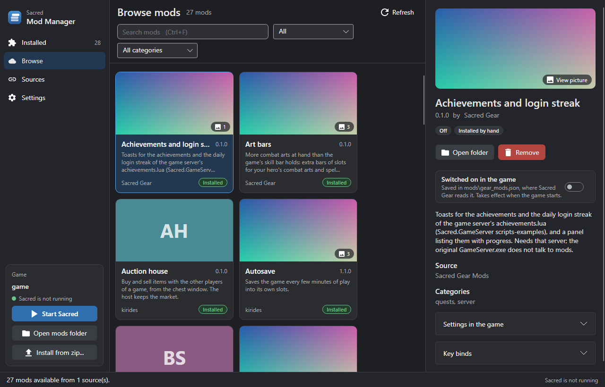

# Development

How to build, test and publish Gear Mod Manager, and how the code is laid out. Players do not need any of this: see the [README](../README.md).

* Native AOT, `win-x64` and `linux-x64`, trimmed, **zero warnings**; .NET 11, Avalonia 12 (first party controls, Fluent theme, light and dark),
  CommunityToolkit.Mvvm source generators, runtime async (`<Features>runtime-async=on</Features>`), compiled bindings everywhere, `System.Text.Json` with source-generated contexts only.
* The game folder is only touched below `<game>\mods\` (mods and the manager's record) and, for plugins, the files a plugin lists.

## Build, test, publish


Requires the .NET 11 SDK (see `global.json`; the projects target `net11.0` with `runtime-async=on` in `Directory.Build.props`) and, for the AOT publish, the Visual Studio C++ build tools.

```powershell
dotnet build SacredModManager.slnx
dotnet test --solution SacredModManager.slnx

# Native AOT, trimmed, zero warnings (warnings are errors)
$env:PATH += ";C:\Program Files (x86)\Microsoft Visual Studio\Installer"   # the AOT targets call vswhere.exe
dotnet publish src/SacredModManager -c Release -r win-x64 -o publish

# Linux (on Linux, with clang and zlib1g-dev installed)
dotnet publish src/SacredModManager -c Release -r linux-x64 -o publish
```

`publish\Gear Mod Manager.exe` (about 19 MB) is the app (the registered link starts it by this name; the assembly is called `GearModManager` because Avalonia finds its resources by assembly name, so the project renames the program file after publish); Avalonia's three native libraries (`libSkiaSharp.dll`, `libHarfBuzzSharp.dll`, `av_libglesv2.dll`) sit
next to it, native AOT cannot fold them in.

| Flag | What |
|---|---|
| `--selftest <index address>` | headless, in a temporary game folder: loads the index, installs a mod with what it requires, switches it off and on, removes, restores, updates; prints one line per check. Proves the published exe does the file, zip, Lua and JSON work |
| `--game <folder>` | use this game folder instead of the saved one; nothing is saved to the settings (use a **copy** for tests) |
| `--link <link>` | (with `--screenshot`, repeatable) handle the link and save the dialog it opens |
| `--source <address>` | use this source instead of the saved ones (repeatable); nothing is saved |
| `gear-mod-manager://...` | a link as the only argument: handed to the running manager, or the manager starts and asks about it |
| `--screenshot <dir>` | save a PNG of every page in light and dark and exit (the images of the docs) |

`SACRED_MODMANAGER_HOME` moves the settings and all data (default: `%APPDATA%\SacredModManager`, `%LOCALAPPDATA%\SacredModManager`).
`tools/make_test_env.py <dir> --copy-mods <game>\mods` builds a throw-away game folder with a local index and the real release zip, and prints the command line.

The solution: `src/SacredModManager.Core` (indexes, loader, packages, store, `gear_mods.json`, the Lua reader, links; no UI), `src/SacredModManager` (Avalonia app) and
`tests/SacredModManager.Tests` (xunit.v3: sandbox escapes and limits, meta-index traversal, zip-slip, install/update/remove/restore of mods, plugins and tools, `gear_mods.json`
round trips, links, theme contrast).

The app is sliced by feature, not by type: a feature's view, view model and helpers sit side by side.

```
src/SacredModManager/
  Features/
    Shell/       MainWindow(.axaml, .cs), MainWindowViewModel (+ .Links.cs): navigation, game folder, loading, every action
    ModList/     ModsPageView + ModsPageViewModel (Installed and Browse), ModItemViewModel, ModDetailView
    Gallery/     GalleryView + GalleryViewModel: the picture carousel
    Dialogs/     DialogView + DialogViewModel: questions and notices inside the window
    Sources/     SourcesPageView + SourcesPageViewModel
    Settings/    SettingsPageView + SettingsPageViewModel
  Themes/        Theme (palettes), Styles, Icons
  Tooling/       ScreenshotRunner, SelfTest (the --screenshot and --selftest flags)
  App.axaml(.cs), Program.cs, Assets/
```

## Nightly builds


`.github/workflows/nightly.yml` builds **Native AOT** binaries for **Windows x64** and **Linux x64** every night (02:17 UTC, or by hand under Actions, *Run workflow*;
*force* builds without new commits). Each build is its own pre-release, tagged `nightly-<sha7>` and titled **"Nightly - YYYY-MM-DD HH:mm - <sha7>"** (UTC); nightlies are kept,
none replaces another. A night without a new commit builds nothing, and a commit whose nightly lacks a platform (a build failed) is built again the next night. Each build runs the
whole test suite on its platform first (the Linux job also runs the Linux-only desktop-file test), publishes with warnings as errors, runs the published program's headless self test (`--selftest` against a tiny local index, `tools/make_smoke_index.py`), and packs
`Gear-Mod-Manager-nightly-win-x64.zip` / `Gear-Mod-Manager-nightly-linux-x64.AppImage` (an **AppImage**: `chmod +x` it and run it; registered links point at the AppImage file). A failing platform does not cancel the release of the other. Nightlies are not releases and can be broken.

## Themes


The dark theme is layered dark grey, never black (window `#1E1F22`, panels `#23252A`, cards `#2A2C30`, raised `#33363B`, borders `#3D4046`, text `#E6E6E6`),
defined with the light one in `src/SacredModManager/Themes/Theme.axaml`; a test computes the WCAG contrast of every text/background pair (at least 4.5).
It follows the system by default and can be set in Settings.


