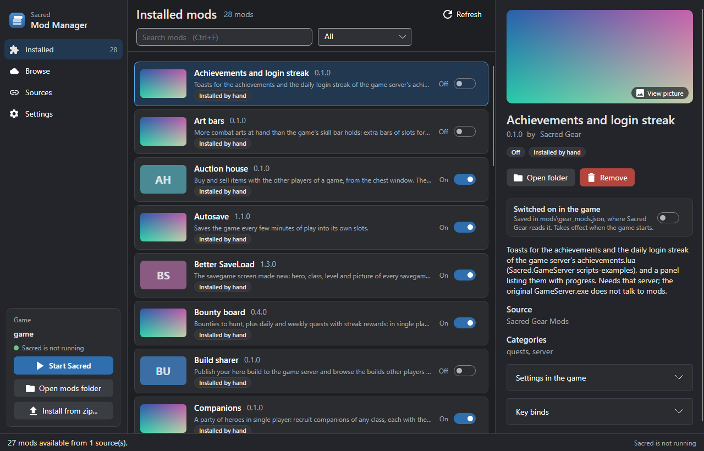
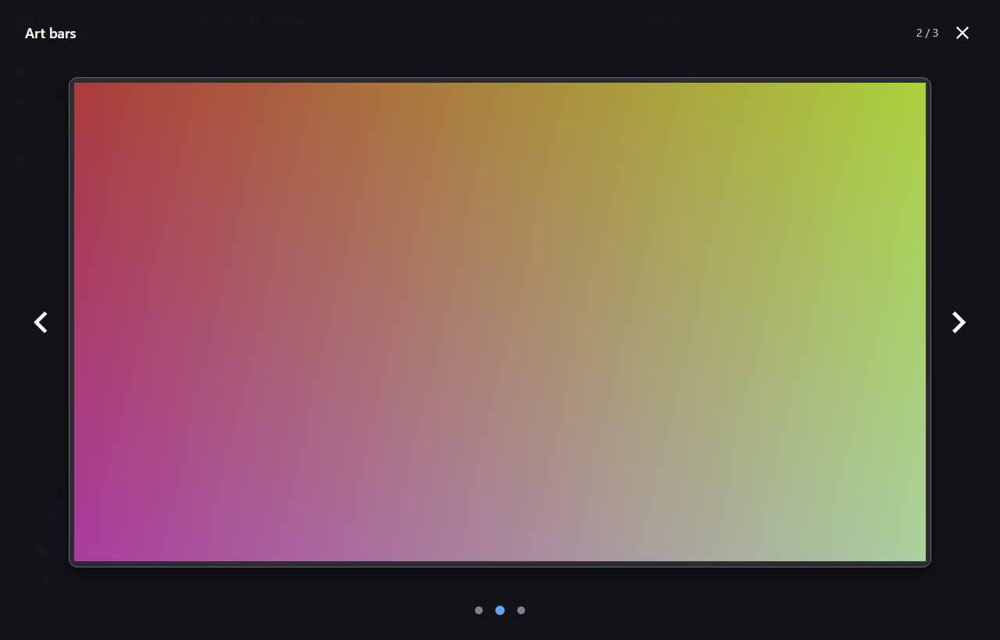
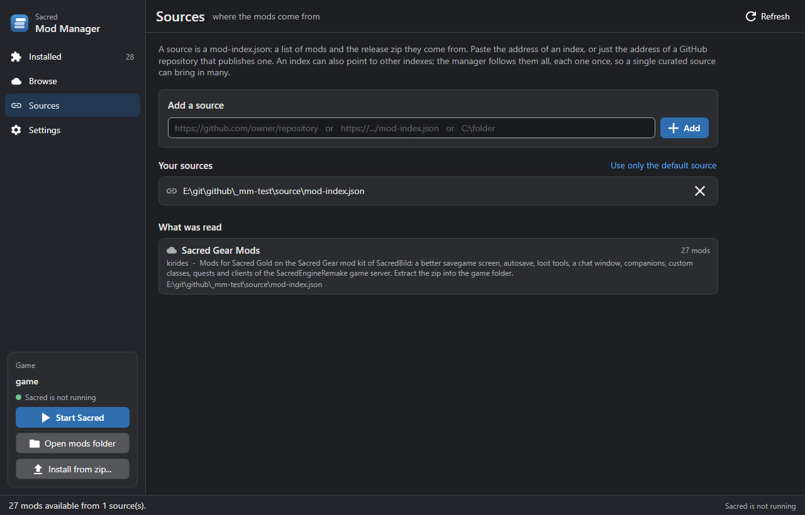

# Features

What Gear Mod Manager does, page by page. For the short version see the [README](../README.md).

## Pages and tabs

| | |
|---|---|
| **Installed** | Every mod in `<game>\mods\` with its version, author, description, state and an On/Off switch. Filters: on, off, updates, problems, installed by hand. Search by name, id, author, description, category. The detail pane shows the mod's requirements, the settings and key binds it declares, and whether files were changed since the install. |
| **Mods, Plugins, Tools** | Both lists have tabs for the three kinds of entries an index can offer: Sacred Gear **mods** (On/Off switch), **plugins** (files for the game folder such as `ddraw.dll` or `SacredGear.dll`; a file you already had is saved and put back when the plugin is removed) and **tools** (programs such as the class editor, unpacked into the tools folder, with a Start button). Entries can be for one platform only, and a download can name a GitHub release (`download.github` + an asset pattern) when the asset's name carries a version. See [docs/ModIndex.md](ModIndex.md#kinds-mods-plugins-and-tools). |
| **Browse** | The mods of all sources as cards with a picture (a path inside the release zip, or an https URL). A click on the picture opens a **carousel** with all the `images` of the mod (arrow keys, dots, `Esc`). Install and Update buttons, category filter. Installing a mod installs what it **requires** first (the dialog lists them). |
| **Sources** | Add, remove and refresh sources. Shows every index that was read, including the ones another index pointed to (indented), their mod counts and errors. |
| **Settings** | Game folder (found automatically in the usual places and the GOG registry entry), theme, where the manager keeps its files. |

Comfort that matters when you have many mods:

* **Update all** with one button; the Browse badge counts available updates.
* **New version of the manager**: a banner says when a newer nightly or release exists, with a button that opens the GitHub release page. Nothing is downloaded. It can be switched off in Settings.
* **Flaky connections**: a dropped connection or a busy server is retried (3 tries), and errors are explained in plain words (which host, what to try).
* **Plugin zips**: a zip with `ddraw.dll` / `SacredGear.dll` is not a mod; "Install from file" says so and offers to add the Sacred-Bild source.
* **Undo** (`Ctrl+Z`, also the link in the status bar) for On/Off, install, update, removal. Before a mod is replaced or removed its folder is copied to
  `%LOCALAPPDATA%\SacredModManager\backups`; **Restore previous** puts the last copy back (the five latest are kept).
* **Updates only overwrite**: the files the new version ships replace the old ones, and **nothing is deleted**, not even a file the new version no longer has (a dead
  lua file is better than a lost one). Mods keep their own data in their folder (saves, boards, settings): it is never touched, by an update or by Remove. If you edited a
  shipped file (or the mod changed it) the detail pane says so, and the copy you had is in the backup. Files that an update leaves behind stay in the manager's record and go
  with **Remove**, which removes exactly the files the manager wrote and keeps the mod's own data unless you tick *also delete the data*.
* **Safe removal**: removes the files the manager wrote and keeps the mod's own data unless you tick *also delete the data and settings*.
* **The game is respected**: while `Sacred.exe` runs the manager refuses to change mods (the game keeps files open and rewrites `gear_mods.json`)
  and says so in a banner. When the game ends the list refreshes itself; so it does when the window gets the focus.
* **Start Sacred** and **Open mods folder** are one click away. Drop a mod **zip** onto the window (or *Install from zip*, `Ctrl+O`) to install mods that
  are not in any index.
* Mods that were put into `mods\` by hand are listed as *Installed by hand* and can be updated from a source, removed or switched like any other.
* Fully usable with the keyboard: `Ctrl+1..4` pages, `Ctrl+F` search, `F5` refresh, `Ctrl+Z` undo, `Ctrl+O` zip, arrows in lists, `Escape` answers a question with "no".
  Questions are asked inside the window; the safe answer has the focus.

## Sources

A `mod-index.json` names a publisher, the release zip and its mods; the schema, the rules for `path` and `thumbnail`, meta-indexes (an index that lists its
own mods **and** references other indexes; each index is read once, cycles are harmless, depth and count are capped) and a script that generates the
file from a mods repository are in **[ModIndex.md](ModIndex.md)**. A source can be typed as

* `https://github.com/owner/repository` (its `mod-index.json` on the default branch),
* the https URL of an index file (`.../releases/latest/download/mod-index.json`),
* a local file or folder (handy while you write an index).

The default source is the index of [sacred-gear-mods](https://github.com/kirides/sacred-gear-mods).

## Links

The manager handles `gear-mod-manager://` links (Windows and Linux, registered for the current user): `gear-mod-manager://add-index?url=<index address>` adds a source,
`gear-mod-manager://install?mod=<id>&index=<index address>` installs a mod. It always asks first. **Copy link** (a mod's detail pane, a source) builds them. Details,
registration and the single-instance hand-over: **[Links.md](Links.md)**.

## Where the On/Off state lives

Sacred Gear keeps the player's choices in `<game>\mods\gear_mods.json`: `{"mods": {"<id>": {"enabled": bool, "settings": {...}, "keys": {...}, "migrated": {...}}}}`.
The manager only ever changes `enabled`. Every change re-reads the file, edits it and writes it back atomically (same folder, temp file, move), so
settings, key binds and any field it does not know survive untouched. A file that cannot be parsed is never overwritten; the manager tells you
and leaves it alone. A mod without an entry follows its own default (`enabled = false` in its `mod.lua` means off until switched on).

The manager's own record of what it installed (version, source, every file with its SHA-256) is `<game>\mods\sacred-mod-manager.json`, so it travels
with the game folder.

## How mod information is read

`mod.lua` is a Lua file that returns a table. The manager reads it with [LuaCSharp](https://github.com/nuskey8/Lua-CSharp) in a state that has **no
libraries at all**: no `io`, `os`, `require`, `load*`, `dofile`, `debug`, no pattern matching, and an empty global table (like Sacred Gear's own manifest loader). The only
addition is a short list of string methods (`("bar%d"):format(n)`, `:sub`, `:rep`, `:lower`, `:upper`, `:len`, `:reverse`, `:byte`, `:char`) that real manifests use to build key lists;
they cannot be reached by name, refuse strings over 64 KB and field widths over 99. A hook counts **every instruction** (limit 2 million), watches the memory the
thread allocates (limit 48 MB) and the clock (2 s), call depth is 64, and the source is limited to 256 KB. A manifest that breaks a limit is reported as
"cannot be loaded" with the reason; nothing else happens. Zip files are unpacked only after every entry name is checked (no `..`, absolute paths, drive letters,
device names), with caps on file count and size.
